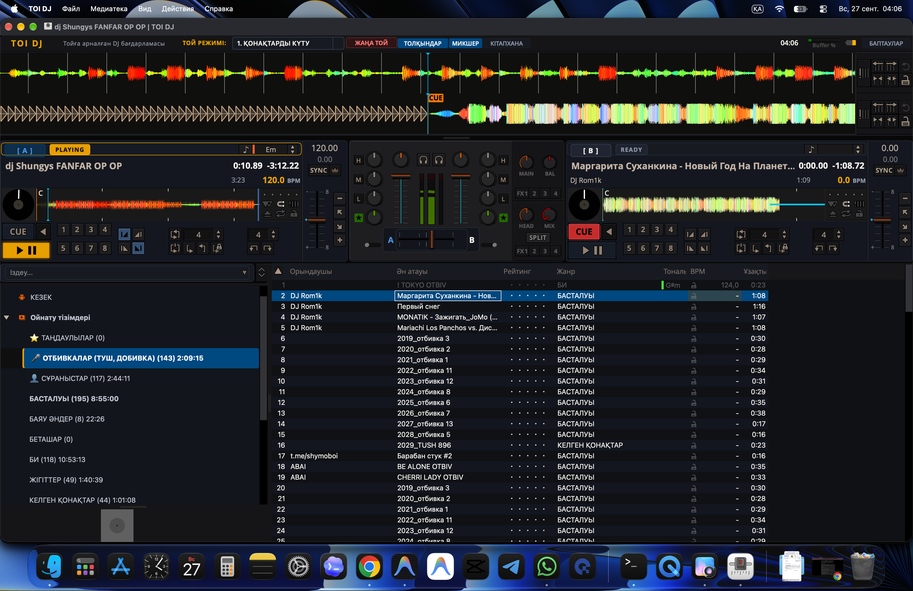

# 🍏 TOI DJ — Ресми Apple-Стиліндегі Таныстыру Сайты

> **Қазақ тойлары мен іс-шараларына арналған мамандандырылған заманауи ашық диджей бағдарламасының ресми веб-сайты.**

<p align="center">
  
</p>

<p align="center">
  <a href="https://azamaperdeev05.github.io/toi-dj/"></a>
  <a href="https://github.com/Azamaperdeev05/toi-dj/releases/latest"></a>
  <a href="https://github.com/Azamaperdeev05/toi-dj"></a>
</p>

---

## 🌐 Тікелей Сілтемелер (Live Links)

- 🚀 **Ресми Сайт:** [https://azamaperdeev05.github.io/toi-dj/](https://azamaperdeev05.github.io/toi-dj/)
- 💻 **Негізгі Бағдарлама Репозиторийі:** [github.com/Azamaperdeev05/toi-dj](https://github.com/Azamaperdeev05/toi-dj)
- 🍏 **macOS DMG Жүктеу (v1.1.0):** [TOI-DJ-1.1.0-macOS-arm64.dmg](https://github.com/Azamaperdeev05/toi-dj/releases/latest/download/TOI-DJ-1.1.0-macOS-arm64.dmg)

---

## ✨ Сайттың Мүмкіндіктері (Features)

1. **Apple Dark Aesthetic:** SF Pro / Plus Jakarta Sans қарпі, Glassmorphism (blur) эффектілері, терең қара градиенттер және Bento Grid стилі.
2. **Интерактивті Spacebar Демосы:** Пернетақтадағы немесе экрандағы Пробелді басқанда тікелей Web Audio API арқылы ырғақ қосылады/тоқтайды және визуалды толқын (Waveform) қимылдайды.
3. **Сахналық Отбивкалар Пульті (Soundboard):** Фанфар, Шымкент шапалақ тушы, Ет келгендегі туш, Күлкі сияқты той дыбыстарын сайттан тікелей тыңдау мүмкіндігі.
4. **12 Той Кезеңі:** Батадан қоштасуға дейінгі кезеңдер тізімі мен `Alt+1..=` жедел пернелер жүйесі.
5. **Мультиплатформа:** macOS (Apple Silicon M1-M4 & Intel), Windows 10/11 және Linux жүйелері үшін орнату нұсқаулықтары.

---

## 🛠️ Жергілікті іске қосу (Local Setup)

Бұл сайт таза HTML5, CSS3 және Vanilla JavaScript (Web Audio API) арқылы жасалған. Ешқандай күрделі құрастырушыны (Node.js/Webpack) қажет етпейді:

```bash
git clone https://github.com/Azamaperdeev05/toi-dj-site.git
cd toi-dj-site
open index.html
```

немесе кез келген жергілікті сервер арқылы:

```bash
npx serve .
```

---

## 👤 Автор және Лицензия

- **Жоба авторы:** [Azamat Perdeev](https://github.com/Azamaperdeev05)
- **Лицензия:** MIT License
